  
  
  

## 🧭 About me

I came to software through two other doors, and that is the point.

A B.A. in Education taught me what learners actually need and which data a learning system genuinely has to collect. An M.S. in Cybersecurity and Information Assurance taught me how to threat-model it. Shipping TypeScript PWAs taught me it is buildable. EdTech is where security is weakest and the stakes are highest: the users are often minors and the data is academic records. That is the problem I work on.

- 🔐 Security practitioner: penetration testing, vulnerability management, threat analysis, incident detection
- 🌍 Builder of secure, offline-first learning platforms for francophone Africa
- 🔭 Preparing applied research for international cybersecurity conferences: offline-first design as a privacy and security architecture, not just a connectivity fix; it makes data minimization a structural fact rather than a policy promise

## 🚀 What I'm building

| Project | What it is |
|---|---|
| 🎓 **[OuraGrove Academy](https://github.com/Ouraking/OuraGrove-Academy)** | Secure, offline-first EdTech platform for francophone Africa; my flagship build |
| 📚 **[Azea](https://github.com/Ouraking/Azea)** | The Togo Encyclopedia: culture, history, and knowledge as open digital infrastructure |
| 🔢 **[Awale Maths](https://github.com/Ouraking/awale-maths)** | Math practice built around Togo's official school curriculum |
| 🛡️ **[Cyber Portfolio](https://github.com/Ouraking/cyber-portfolio)** | My security work in one place: labs, audits, and architecture write-ups |

## 🛡️ Security side

  
  
  
  
  
  
  
  

M.S. in Cybersecurity and Information Assurance (Western Governors University). Day to day I work with Rapid7 InsightVM, AppSec, and InsightIDR, and I run a home lab on Proxmox with pfSense, Wazuh, and Docker where I break things on purpose before someone else does.

## 🧰 Stack

  
  
  
  
  
  
  
  

## 📊 GitHub stats

  
  

  

## 🤝 Community

- 🛡️ Founder, **Togo Cybersecurity Research Collective (TCRC)**
- 🧑‍🏫 Co-organized high school youth hackathons promoting early tech literacy
- 🎤 MIT Africa Innovate Hackathon · Harvard Africa Development Conference · ISACA GranIT
- 📜 Member: IEEE · PMI · ISACA

